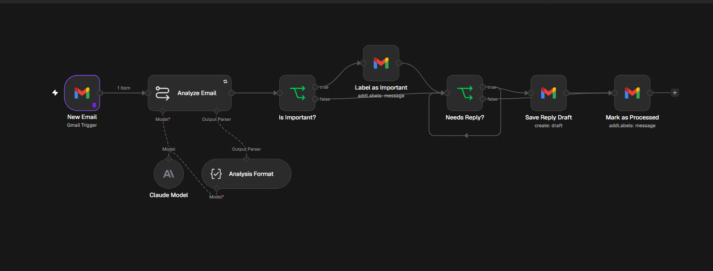

# AI Email Assistant for Gmail (n8n)

An n8n workflow that reads new Gmail emails, summarizes them, marks important ones,
and saves a suggested reply as a draft, only when the email actually needs a reply.
Nothing is ever sent automatically.

## What it does
1. Checks Gmail every minute for new emails (skips Promotions and Social)
2. Claude AI writes a summary, picks important/normal, sets a priority, and decides if a reply is needed
3. Important emails get Gmail's "Important" label
4. If a reply is needed, a draft reply is saved in the same thread
5. Adds an "AI-Processed" label so no email is handled twice

## Setup
1. In n8n, create a new workflow, then **Workflow menu (⋯) → Import from file** and choose the `.json` file
2. In Gmail, create a label named `AI-Processed`
3. Connect your Gmail account on all 4 Gmail steps
4. On the **Claude Model** step, use Gateway credits (n8n Cloud) or add your own Anthropic API key
5. On **Mark as Processed**, select your `AI-Processed` label
6. Edit the instructions on **Analyze Email** to match your own priorities and name
7. Test it with one email, then publish

## Requirements
- n8n (Cloud or self-hosted)
- A Gmail account
- Claude access (Gateway credits on n8n Cloud, or an Anthropic API key)

## License
MIT
